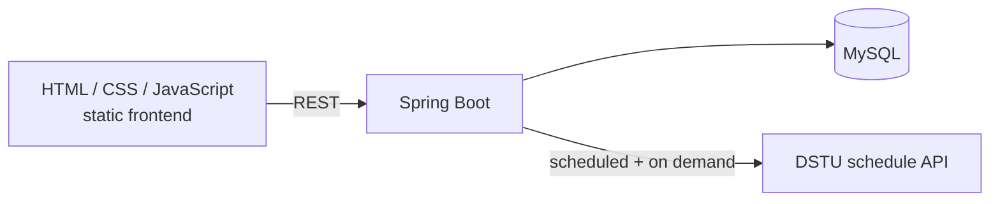

# DSTU Lab Queue Booking

A web application for booking a slot to defend lab assignments with a teacher at **Don State Technical University (DSTU)**. It pulls the real university timetable from the **public DSTU schedule API**, so students see the teacher's actual classes and can queue up for them.

The project was developed by a student team for the *Java Programming* course (2nd year, semester 4) and was **considered by the university for adoption**.

## Features

- **Groups and timetable from DSTU:** the list of study groups and each group's schedule are loaded from the open API (`edu.donstu.ru/api/raspGrouplist`, `edu.donstu.ru/api/Rasp`) and stored in the database; a scheduler keeps the group list up to date.
- **Authentication:** sign-up and login for students.
- **Booking UI:** a mobile-friendly page with the timetable, a queue for lab defence slots, notifications and a profile page.

## Architecture



| Layer | Details |
|---|---|
| Backend | Java 17, Spring Boot 3 (Web, Data JPA, JDBC), MySQL; controllers for groups (`/api/groups`), schedule (`/api/schedule`) and users (`/login`); services, JPA repositories and a `GroupDataScheduler` |
| Frontend | Plain HTML, CSS and JavaScript served from `src/main/resources/static`: authorization, schedule view with extensions, booking queue |

## Branches

| Branch | Content |
|---|---|
| `main` | Latest version: backend from `authorization` plus the complete frontend (May 2025) |
| `authorization`, `schedule`, `groups`, `website`, `authorization-website`, `authorization-website-2`, `master` | The team's feature branches, kept as they were developed |
| `initial-commit` | The repository's first commit |

## How to run

Requirements: JDK 17 and a MySQL database.

```bash
export DB_URL=jdbc:mysql://localhost:3306/queue_project
export DB_USERNAME=...
export DB_PASSWORD=...
./mvnw spring-boot:run
# open http://localhost:8081
```

Database credentials are read from environment variables; they were removed from every commit of the history before publishing.

## Team

| Member | Contribution |
|---|---|
| **Mark Bulgarov ([@MP4-Player](https://github.com/MP4-Player))** | Frontend (authorization, schedule and booking pages) and integration with the timetable API |
| [@meeporen](https://github.com/meeporen) (Karen Karamyan) | Backend: schedule service and API |
| [@dobryydenechek](https://github.com/dobryydenechek) | Repository owner, project setup |
| Kate | Group collector |
| vladulik | Authorization |

Originally developed in [dobryydenechek/queue_project](https://github.com/dobryydenechek/queue_project); this copy keeps the full team history.

## Credits

Decorative background images are from [Freepik](https://www.freepik.com).
